<div align="center">


</div>


**World Time** is a project by [Syed Raqi](https://github.com/SyedRaqi) about time around the world: the hours that tick differently in every city, and the twenty-four time zones that tie them together.












<sub>The globe, clocks and time-zone graphics on this page are illustrations of the idea, not screenshots of the application.</sub>


```bash
git clone https://github.com/SyedRaqi/World-time.git
cd World-time
```


